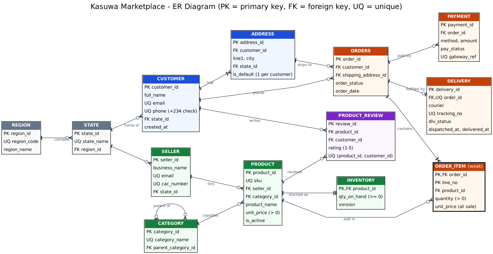

# Portfolio 1 — Database Design and Modelling

## 1. Case study: Kasuwa Marketplace (simulated organisation)

| Item | Description |
|---|---|
| **Organisation / scenario** | *Kasuwa Marketplace* — a simulated Nigerian multi-vendor e-commerce platform ("kasuwa" means *market* in Hausa). Independent sellers list products; customers in all 36 states and the FCT order online; third-party couriers deliver. |
| **Nature of the business** | Online retail marketplace (electronics, fashion, home & kitchen, groceries, health & beauty). Payments by card, bank transfer, USSD, wallet or pay-on-delivery. |
| **Users of the database** | Customers (browse, order, review), sellers (manage listings and stock), operations staff (fulfilment, delivery tracking), finance (payment reconciliation), management (sales reporting), and the platform's web/mobile application. |
| **Major data stored** | Customers and addresses, sellers, product catalogue and category hierarchy, inventory, orders and order lines, payments, deliveries, product reviews, stock-movement audit trail, Nigerian states and geopolitical zones. |
| **Key operations** | Register customer; list product; search catalogue; place order (reserve stock, take payment); update stock; track delivery; post review; sales and revenue reporting by region/category. |

This same case study is used in **all five portfolio activities**.

## 2. Entity Relationship Diagram



Source: [`erd.dot`](erd.dot) (Graphviz, crow's-foot notation; regenerate with `dot -Tpng erd.dot -o erd.png`). Vector version: [`erd.svg`](erd.svg).

Key relationships and cardinalities:

| Relationship | Cardinality | Notes |
|---|---|---|
| REGION — STATE | 1 : N | six geopolitical zones group the 37 states |
| CUSTOMER — ADDRESS | 1 : 1..N | at least one address, exactly one default |
| CUSTOMER — ORDERS | 1 : 0..N | |
| ORDERS — ORDER_ITEM | 1 : 1..N | ORDER_ITEM is a **weak entity** identified by (order_id, line_no) |
| PRODUCT — ORDER_ITEM | 1 : 0..N | resolves the M:N between ORDERS and PRODUCT |
| PRODUCT — INVENTORY | 1 : 1 | stock kept in its own table so stock updates don't lock catalogue rows |
| ORDERS — PAYMENT | 1 : 0..N | several attempts allowed (failed then successful) |
| ORDERS — DELIVERY | 1 : 0..1 | enforced by `UNIQUE(order_id)` on DELIVERY |
| CATEGORY — CATEGORY | 1 : 0..N | recursive (unary) relationship for the category tree |
| CUSTOMER / PRODUCT — PRODUCT_REVIEW | M : N with attributes | one review per customer per product |

## 3. Relational schema

Full DDL: [`01_schema.sql`](01_schema.sql). Notation: **PK** underlined-equivalent, *FK* italic.

```
REGION(region_id PK, region_code UQ, region_name)
STATE(state_id PK, state_name UQ, region_id FK→REGION)
CATEGORY(category_id PK, category_name UQ, parent_category_id FK→CATEGORY)
CUSTOMER(customer_id PK, full_name, email UQ, phone UQ, state_id FK→STATE, created_at)
ADDRESS(address_id PK, customer_id FK→CUSTOMER, line1, city, state_id FK→STATE, is_default)
SELLER(seller_id PK, business_name, email UQ, cac_number UQ, state_id FK→STATE, joined_at)
PRODUCT(product_id PK, sku UQ, seller_id FK→SELLER, category_id FK→CATEGORY, product_name, unit_price, is_active, created_at)
INVENTORY(product_id PK/FK→PRODUCT, qty_on_hand, version, updated_at)
ORDERS(order_id PK, customer_id FK→CUSTOMER, shipping_address_id FK→ADDRESS, order_status, order_date)
ORDER_ITEM(order_id PK/FK→ORDERS, line_no PK, product_id FK→PRODUCT, quantity, unit_price)
PAYMENT(payment_id PK, order_id FK→ORDERS, method, amount, pay_status, gateway_ref UQ, paid_at)
DELIVERY(delivery_id PK, order_id FK/UQ→ORDERS, courier, tracking_no UQ, dlv_status, dispatched_at, delivered_at)
PRODUCT_REVIEW(review_id PK, product_id FK, customer_id FK, rating, review_text, created_at, UQ(product_id, customer_id))
STOCK_MOVEMENT(movement_id PK, product_id FK, change_qty, reason, order_id FK, moved_at)
```

## 4. Keys and constraints

| Type | Where | Purpose |
|---|---|---|
| Surrogate primary keys (`GENERATED ALWAYS AS IDENTITY`) | most tables | stable, compact join keys; natural keys can change (e.g. a customer changes email) |
| Natural candidate keys as `UNIQUE` | email, phone, sku, cac_number, gateway_ref, tracking_no | prevent duplicates the business cares about; `gateway_ref` also acts as a payment **idempotency key** |
| Composite primary key | `order_item(order_id, line_no)` | weak entity identified through its owner |
| Composite unique | `product_review(product_id, customer_id)`, `order_item(order_id, product_id)` | one review per customer/product; a product appears once per order |
| Partial unique index | `address(customer_id) WHERE is_default` | at most one default address per customer — a rule a plain UNIQUE cannot express |
| CHECK (column) | price > 0, quantity > 0, rating 1–5, qty_on_hand ≥ 0, status/method domains, phone regex `^\+234[0-9]{10}$` | domain integrity inside the DBMS |
| CHECK (table) | `delivered_at >= dispatched_at` | cross-column rule |
| Foreign keys with chosen actions | `ON DELETE CASCADE` for owned data (address, order_item, review); default `RESTRICT` for history (a product on past orders cannot be deleted) | referential integrity matched to business meaning |

**Evidence that the constraints are enforced:** [`03_constraint_tests.sql`](03_constraint_tests.sql) attempts ten invalid operations; every one is rejected by PostgreSQL — see [`evidence/constraint_tests_output.txt`](evidence/constraint_tests_output.txt).

## 5. Normalisation

The design was produced top-down from the ERD and then checked bottom-up against an un-normalised order form.

**Un-normalised (UNF)** — one row per order as a paper invoice would show it:

`ORDER_FORM(order_id, order_date, customer_name, customer_email, customer_phone, address, state, region, {sku, product_name, category, seller_name, unit_price, quantity}, payment_method, amount, courier, tracking_no)`

**1NF** — remove the repeating product group so each cell is atomic:
`ORDER_LINE(order_id, sku, order_date, customer_email, …, product_name, seller_name, unit_price, quantity, …)` with key (order_id, sku).

**2NF** — remove partial dependencies on part of the composite key:
- `order_id → order_date, customer_email, payment_method, courier …` ⇒ moved to **ORDERS**
- `sku → product_name, category, seller_name, current price` ⇒ moved to **PRODUCT**
- remaining `(order_id, sku) → quantity, unit_price_at_sale` ⇒ **ORDER_ITEM**

**3NF** — remove transitive dependencies:
- `order_id → customer_email → customer_name, phone` ⇒ **CUSTOMER**
- `customer → state → region` ⇒ **STATE**, **REGION**
- `product → seller_id → business_name, cac_number` ⇒ **SELLER**
- `order_id → tracking_no → courier, dlv_status` ⇒ **DELIVERY**; payments ⇒ **PAYMENT**

**BCNF check** — in every table each non-trivial determinant is a candidate key (e.g. in CUSTOMER both `customer_id` and `email` determine all attributes, and both are keys). No table has an overlapping-candidate-key anomaly, so the schema is in **BCNF**.

**Two deliberate design decisions worth defending**

1. `order_item.unit_price` looks like a copy of `product.unit_price`, but it is **not redundant**: it records the price *at the moment of sale*, which is a different fact. If it were removed, a price change today would silently rewrite last year's revenue.
2. The order total is **not stored**. It is derived by the view `v_order_total`. Storing it would create an update anomaly (change a line, forget the total). If reporting performance later required it, it would be added as a controlled denormalisation (trigger-maintained or materialised view) — this trade-off is revisited in Portfolio 2.

## 6. How to build and test

```bash
createdb kasuwa
psql -d kasuwa -f 01_schema.sql          # tables, keys, constraints, view
psql -d kasuwa -f 02_seed_data.sql       # ~1.3 million rows of reproducible synthetic data (~35 s)
psql -d kasuwa -f 03_constraint_tests.sql   # all 10 statements must fail
```

Data volumes after seeding (from [`evidence/table_row_counts.txt`](evidence/table_row_counts.txt)): 50,000 customers, 400 sellers, 5,000 products, 300,000 orders, 600,153 order lines, 280,377 payments and deliveries, 38,736 reviews. Product popularity is skewed (power law) and order volume grows over time, so query plans in Portfolio 2 behave like a real store rather than uniform test data.

Tested on PostgreSQL 16.15 (Ubuntu 24.04).
