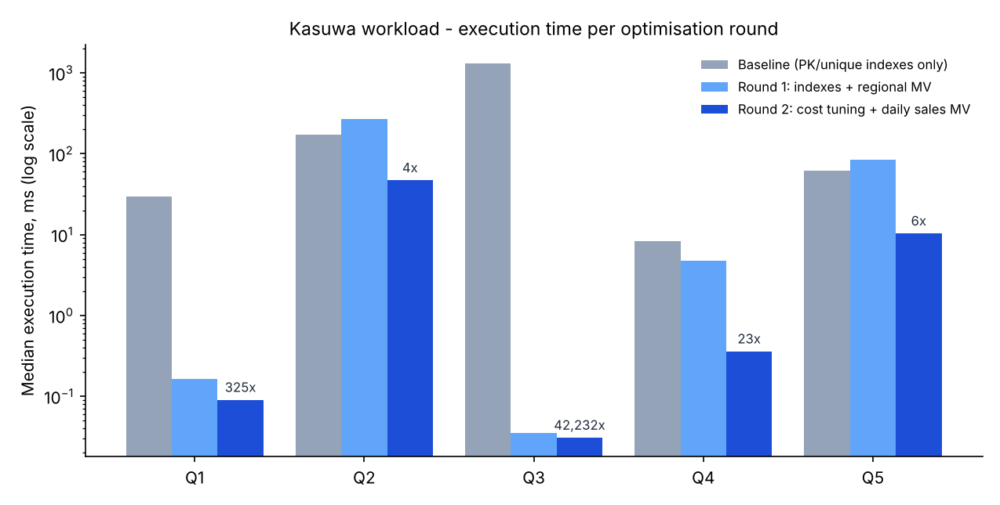

# Portfolio 2 — Query Processing and Optimisation

Case study: **Kasuwa Marketplace** (same database as Portfolio 1: 300,000 orders, 600,153 order lines, 50,000 customers, 5,000 products). PostgreSQL 16.15.

## 1. Workload

Five queries were chosen because each represents a real screen or report and stresses a different part of the optimiser. Full SQL: [`queries.sql`](queries.sql).

| ID | Business use | What makes it interesting |
|---|---|---|
| Q1 | Customer "My Orders" page (latest 10 orders + totals) | OLTP lookup that runs on every page view; filter + sort + LIMIT |
| Q2 | Top 10 Electronics products by revenue, last 30 days | recursive CTE over the category tree, date range, 3-way join, aggregation |
| Q3 | Monthly revenue per geopolitical zone, 2026 | 5-way join over ~70% of all data, heavy aggregation |
| Q4 | Catalogue search box `ILIKE '%air fryer%'` | leading wildcard — a B-tree index can never help |
| Q5 | Open deliveries for orders older than 3 days | very selective status (~1% of deliveries) |

## 2. Method

[`run_benchmark.py`](run_benchmark.py) measures every query in three phases. Each measurement = 1 discarded warm-up run + 7 runs of `EXPLAIN (ANALYZE, BUFFERS)`; the **median** execution time is reported, so all phases are compared with a warm cache. Every plan is saved in [`plans/`](plans/) (e.g. `Q1_baseline.txt`, `Q1_round1.txt`, `Q1_round2.txt`).

| Phase | What was applied |
|---|---|
| baseline | only the PK/UNIQUE indexes from Portfolio 1, default settings |
| round 1 | [`optimisations_round1.sql`](optimisations_round1.sql) — one targeted object per query |
| round 2 | [`optimisations_round2.sql`](optimisations_round2.sql) — written *after* analysing round-1 plans |

Where a query was **rewritten** (Q3 and Q2 read materialised views), the harness also runs the original and checks the rows are identical — see [`evidence/result_equivalence.txt`](evidence/result_equivalence.txt) (all `identical=True`).

## 3. Results



Median execution time in ms (raw data: [`evidence/benchmark_results.csv`](evidence/benchmark_results.csv)):

| Query | Baseline | Round 1 | Round 2 | Overall | Plan change (baseline → final) |
|---|---:|---:|---:|---:|---|
| Q1 | 29.60 | 0.165 | **0.091** | 325× | parallel seq scan of 300k orders → index scan on `ix_orders_customer_date` |
| Q2 | 173.48 | 272.08 | **47.27** | 3.7× | hash join over all 600k order lines → scan of `mv_daily_product_sales` |
| Q3 | 1,309.20 | 0.035 | **0.031** | ~42,000× | 5-way hash join → read 60 pre-aggregated rows |
| Q4 | 8.25 | 4.80 | **0.362** | 23× | seq scan + `ILIKE` filter on every product → trigram GIN bitmap scan |
| Q5 | 61.73 | 84.15 | **10.40** | 5.9× | parallel seq scan of deliveries → partial index + nested loop on `orders_pkey` |

## 4. Analysis

**Q1 — composite index matches filter *and* sort.** In the baseline plan PostgreSQL found the customer quickly through the `email` unique index, but then had to scan all 300,000 orders in parallel to find that customer's orders (2,850 buffers). PostgreSQL does not index foreign keys automatically. `orders(customer_id, order_date DESC)` lets it jump to one customer's rows already in date order; buffers fell from 2,850 to 32.

**Q2 — round 1 failed, which was the most useful result.** The date index was used, but time got *worse* (173 → 272 ms). The plan shows why: the hash join still reads all 600k order lines, and because order ids grow with time, the recent lines sit at the end of the table, so no row is produced until the scan finishes. Before choosing a fix I tested alternatives ([`evidence/q2_investigation.txt`](evidence/q2_investigation.txt)): forcing a nested loop was faster (diagnostic only — planner flags are fragile in production) and a covering index gave no gain. Because Q2 is a report, I pre-aggregated sales per product per day. Result 47 ms (3.7×). The gain is smaller than expected because the daily view is still large (27 MB, see [`evidence/optimisation_object_sizes.txt`](evidence/optimisation_object_sizes.txt)): most product-day combinations sell only once, so daily aggregation barely shrinks the long tail. A weekly grain or a summary table maintained by trigger would be the next step.

**Q3 — materialised view; the cost moves, it does not disappear.** The query is fast because work is done in advance. A concurrent refresh takes ~2.5 s ([`evidence/mv_refresh_timing.txt`](evidence/mv_refresh_timing.txt)), so this is right for a dashboard refreshed nightly and wrong for anything that must be live. `REFRESH ... CONCURRENTLY` needs the unique index created on the view, and it lets readers keep using the old data during refresh.

**Q4 and Q5 — the cost model mattered more than the index.** After round 1 the trigram index and the partial index both existed, but the planner ignored the first and used the second badly: for Q5 it read the 3,728 open deliveries through the tiny partial index (104 kB versus 6 MB for the full PK index) and then hash-joined them against all 300k orders, making Q5 slower than baseline. The default `random_page_cost = 4` assumes spinning disks, where random reads are expensive. This server runs on SSD with the data in RAM, so in round 2 I set `random_page_cost = 1.1` (a common SSD setting). The planner then chose index probes for both queries: Q5 fell to 10 ms and Q4 started using the trigram index (0.36 ms).

## 5. Trade-offs and lessons

- Indexes are not free: the five round-1 indexes add about 20 MB and slow every `INSERT` on `orders` and `order_item`. I only kept indexes that a measured query actually used.
- An index existing is not the same as the planner using it. Reading `EXPLAIN ANALYZE` and comparing **estimated vs actual rows** is what explained Q2 and Q5.
- Materialised views trade freshness for speed. Operational screens (Q1, Q4, Q5) still read live tables; only reports (Q2, Q3) read views.
- Timings are from a single machine and vary ±20% between runs; the plan changes and buffer counts are the more reliable evidence.

## 6. How to reproduce

```bash
pip install psycopg2-binary matplotlib
python3 run_benchmark.py        # ~2 minutes; rewrites plans/ and evidence/
```
