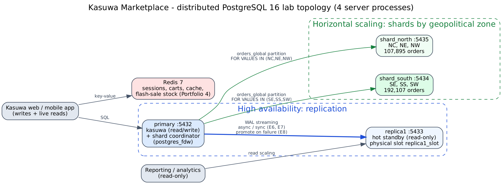

# Portfolio 5 — Distributed and Cloud Database Exercise

Case study: **Kasuwa Marketplace**. Two growth problems are addressed: (1) the platform must survive the loss of its database server (**availability**), and (2) order volume is growing ~20% per quarter, so eventually one server cannot hold or process all orders (**scalability**). Both were built and tested, not only described.



## 1. What was built ([`01_setup_cluster.sh`](01_setup_cluster.sh), [`02_sharding.sql`](02_sharding.sql))

Four independent PostgreSQL 16 server processes, each with its own data directory, WAL and port (equivalent to four VMs without network latency):

| Node | Port | Role |
|---|---|---|
| primary | 5432 | read/write Kasuwa database; also the **shard coordinator** |
| replica1 | 5433 | **hot standby** built with `pg_basebackup -R`, streaming WAL through a physical replication slot |
| shard_south | 5434 | orders of customers in the SE, SS and SW zones |
| shard_north | 5435 | orders of customers in the NC, NE and NW zones |

**Sharding design.** `kasuwa_dist.orders_global` is a LIST-partitioned table whose two partitions are *foreign tables* on the shard servers (`postgres_fdw`). Shard key = the customer's geopolitical zone. Each shard table has a `CHECK` that rejects keys it does not own. Inserting 300,002 orders through the coordinator routed them automatically: **192,107 to shard_south, 107,895 to shard_north** (the south holds Lagos and Rivers, so it is larger — a real hot-shard risk discussed below).

## 2. Experiments ([`03_distributed_tests.py`](03_distributed_tests.py) → [`evidence/03_distributed_tests_output.txt`](evidence/03_distributed_tests_output.txt))

| # | Experiment | Result |
|---|---|---|
| E1 | Query **with** the shard key (`region_code = 'SS'`) | plan shows a single `Foreign Scan on orders_south`; shard_north is never contacted (partition pruning) |
| E2 | Customer lookup **without** the shard key | `Merge Append` over **both** shards (scatter-gather), 1.06 ms; adding the key, which the app knows from the session, prunes to one shard, 0.69 ms |
| E3 | Revenue per state across all shards | partition-wise aggregate OFF: coordinator pulls every row, 230 ms. ON: `GROUP BY` pushed to each shard (`Relations: Aggregate on …` in the plan), shards run in parallel (`Async Foreign Scan`), only 37 rows return: **56 ms** (4× faster). Same report on the single-node relational schema: 759 ms |
| E4 | shard_north stopped | south-zone queries keep working (192,107 rows counted); a global query fails with `could not connect to server "srv_shard_north"`; after restart, all 300,002 orders are visible again |
| E5 | Streaming replication | `pg_stat_replication`: replica1 `streaming`, `async`, 0 bytes behind. Commit-on-primary → visible-on-standby: median 1.07 ms (max 1.74 ms) over 20 trials. Writing to the standby fails: `cannot execute INSERT in a read-only transaction` |
| E6 | Commit latency vs durability, 300 commits each | `synchronous_commit=local` (async) 0.61 ms · `on` (standby flushed) 1.27 ms · `remote_apply` (standby applied) 1.16 ms. Synchronous modes roughly **double** commit latency even with zero network distance; on a real network add the round-trip time |
| E7 | **CAP in practice**: synchronous primary, standby stopped | the commit hangs (`wait_event = SyncRep`) — the system refuses to acknowledge rather than risk inconsistency (**C over A**). Cancelling it gives PostgreSQL's warning *"committed locally, but might not have been replicated"*. Switching back to async restores writes (**A over C**); the standby reconnects through its slot and catches up (0 bytes behind) |
| E8 | **Failover**: primary killed (`-m immediate`) | standby promoted with `pg_promote()` in ~100 ms and accepted writes; all **923 of 923** rows committed on the old primary were present on the new one |

Shard load time (42 s for 300k rows) is in [`evidence/02_sharding_load_output.txt`](evidence/02_sharding_load_output.txt): `postgres_fdw` sends one row per round trip by default. Setting the server option `batch_size` (e.g. 1000) is the fix for bulk loads.

## 3. Analysis

**Replication vs sharding solve different problems.** Replication copies *all* data, so it gives availability and read scaling but no write scaling — every write still goes to one primary. Sharding splits data, so it scales writes and storage, but each shard is a new single point of failure (E4). Production needs both: each shard should itself be a primary + standby pair.

**Choice of shard key.** Zone was chosen because most Kasuwa queries are local (a customer's own orders, deliveries within a zone, regional reports), and because it allows data to be placed near users. Its weaknesses were visible in the lab:
- *Skew*: 64% of orders landed on one shard. A hash of `customer_id` would balance load evenly but lose zone locality; a middle ground is to split the south into two shards (Lagos alone, the rest of the south).
- *Scatter-gather*: any query without the key (E2) hits all shards. Kasuwa can always supply the key for customer screens, but global analytics should run on a separate warehouse, not on the shards.
- *Cross-shard transactions*: an order touches one customer, so it stays on one shard. Anything spanning shards (a seller in Kano selling to a buyer in Port Harcourt, if orders were sharded by seller) would need two-phase commit, which `postgres_fdw` does not provide atomically. Sharding by customer zone avoids this.

**Consistency model.** The lab shows the trade-off concretely: async replication has a short window (~1 ms here, longer under load or on a WAN) where a committed order exists on the primary but not the standby; if the primary fails inside that window the order is lost. For Kasuwa's payment and order tables that is not acceptable, so the target design uses synchronous replication **with at least two standbys** (`synchronous_standby_names = 'ANY 1 (s1, s2)'`), so one standby failing does not block commits as it did in E7. Catalogue and analytics replicas can stay async (eventual consistency is fine for reports).

## 4. Cloud deployment design (proposed)

| Concern | Design for Kasuwa | Lab evidence it rests on |
|---|---|---|
| Database service | Managed PostgreSQL (e.g. Amazon RDS/Aurora PostgreSQL, Azure Database for PostgreSQL Flexible Server, or Google Cloud SQL) — patching, backups, failover handled by the provider | same engine and features as tested |
| High availability | primary + synchronous standby in a **second availability zone**, automatic failover; plus one async read replica for reporting | E5–E8 |
| Scaling writes | when one primary is saturated: shard orders by zone (Citus, the open-source PostgreSQL sharding extension, or coordinator/application routing as in this lab) | E1–E4 |
| Cache / key-value | managed Redis (ElastiCache / Azure Cache for Redis / Memorystore) with replication enabled | Portfolio 4 |
| Backup & recovery | daily snapshots + continuous WAL archiving for point-in-time recovery; restore drill every quarter | — |
| Data location & law | personal data of Nigerian customers falls under the **Nigeria Data Protection Act 2023**; choose a region (or an in-country data centre) and cross-border transfer safeguards accordingly; keep the region close to users to limit latency | sync-commit latency in E6 grows with distance |
| Security | private subnets only, TLS in transit, encryption at rest, separate DB roles for app / reporting / admin | — |

*Not deployed to a public cloud*: the exercise was run on a single Linux host to keep it reproducible and free of cost. The topology maps one-to-one onto the managed services above.

## 5. How to reproduce

```bash
sudo bash 01_setup_cluster.sh                       # primary restart, replica1, two shards
psql -h localhost -p 5432 -d kasuwa -f 02_sharding.sql
sudo python3 03_distributed_tests.py > evidence/03_distributed_tests_output.txt
```
E8 promotes replica1 and the clean-up step restarts the original primary, so replica1 is left diverged. Re-run `01_setup_cluster.sh` to rebuild it before running the tests again (in production, `pg_rewind` would turn the old primary into the new standby instead).
